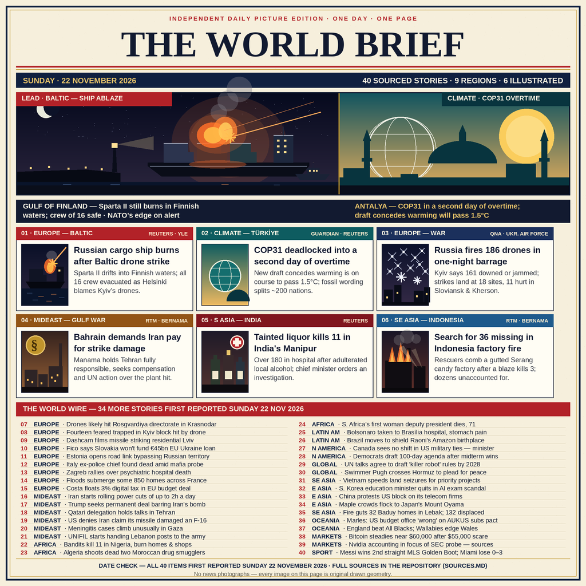

# The World Brief — Sunday 22 November 2026: 40 sourced stories, 9 regions, 6 illustrated

An original editorial front-page poster for [make.fun](https://make.fun/bounty/news-image-20261122): one day of world news — Sunday, 22 November 2026 — summed up in a single 1024 × 1024 image. Six lead stories are illustrated with drawn geometry; a World Wire column adds 34 more dated stories across nine regions. The poster contains no news photography; every illustration is original vector-style geometry drawn by `render.py` (Pillow, deterministic, supersampled 2048 → 1024). Full source list: see `SOURCES.md`.

## The six illustrated stories

1. **Baltic / Gulf of Finland.** The Russian military-linked cargo ship Sparta II, set ablaze by a drone strike, drifted into Finnish waters still burning; all 16 crew were evacuated to a Russian rescue ship as Finland blamed Ukrainian drones. (Reuters, Yle, 22 Nov 2026)
2. **COP31, Türkiye.** The UN climate summit in Antalya ran into a second day of overtime with no deal; a new presidency draft concedes warming is on course to pass 1.5°C while fossil-fuel wording still splits nearly 200 nations. (The Guardian, Reuters, 22 Nov 2026)
3. **Ukraine.** Russia launched 186 drones overnight; Ukraine's Air Force said 161 were shot down or jammed, with strikes recorded at 18 locations and 11 people injured in Sloviansk and Kherson. (QNA, Ukrainian Air Force, 22 Nov 2026)
4. **Bahrain / Gulf.** Bahrain demanded Iran be held fully responsible for the strike on a civilian industrial facility, pay compensation for the damage, and called for UN action. (RTM, Bernama, 22 Nov 2026)
5. **India.** At least 11 people died and more than 180 were hospitalised in Manipur after drinking adulterated locally made alcohol; the chief minister promised an investigation. (Reuters, 22 Nov 2026)
6. **Indonesia.** Rescuers continued searching for 36 people missing after a fire gutted a confectionery factory in Serang; three people were confirmed dead. (RTM, Bernama, 22 Nov 2026)

## The World Wire (34 more, all first reported Sunday 22 Nov 2026)

Drones likely hit the Rosgvardiya directorate in Krasnodar · Fourteen feared trapped in a Kyiv apartment block hit by a drone · Dashcam films a missile striking residential Lviv · Slovakia's Fico says his country won't fund the €45bn EU loan for Ukraine · Estonia opens a road link bypassing Russian territory · Italy's former police chief De Gennaro found dead amid a mafia-probe accusation · Zagreb rallies over a psychiatric hospital death · Floods submerge some 850 homes across France · EU chair Costa floats a 3% digital tax in the budget deal · Iran starts rolling power cuts of up to two hours a day · Trump seeks a permanent deal barring Iran's nuclear weapons · Qatari delegation holds talks in Tehran · US denies Iran's claim its missile damaged an F-16 over the Gulf · Meningitis cases climb unusually in Gaza · UNIFIL starts handing its south Lebanon posts to the Lebanese army · Bandits kill 11 in Nigeria and burn homes and shops · Algeria shoots dead two Moroccan drug smugglers · South Africa's first woman deputy president, Phumzile Mlambo-Ngcuka, dies at 71 · Bolsonaro taken to a Brasília hospital with abdominal pain · Brazil moves to protect the Amazon birthplace of Chief Raoni · Canada's defence minister sees no shift in US military ties · Democrats draft a 100-day agenda after their midterm wins · UN talks agree to start drafting 'killer robot' rules by 2028 · Swimmer Lewis Pugh crosses the Strait of Hormuz to plead for peace · Vietnam speeds land seizures for priority projects · South Korea's education minister quits over an AI exam-cheating scandal · China protests the US block on its telecom firms · Maple crowds flock to Japan's Mount Oyama · Fire guts 32 Baduy homes in Lebak, displacing 132 · Australia's Marles says the US budget office is 'wrong' on the AUKUS submarine pact · England beat the All Blacks as the Wallabies edge Wales · Bitcoin steadies near $60,000 after a slide toward $55,000 · Nvidia's accounting in focus of an SEC probe, sources say · Messi wins a second straight MLS Golden Boot as Inter Miami lose 0–3.

## Design notes

The hero pairs the day's two running stories: the burning Sparta II in the Gulf of Finland (lighthouse, rescue vessel standing off, drone streaks) beside a second dawn of overtime at COP31 in Antalya. Panel icons are drawn for the day — a drone swarm for the 186-drone barrage, a §-sealed claim coin over the Bahrain plant, bottles with a medical warning badge for Manipur, and a searched, smoking factory for Serang. The layout keeps the series' discipline: every headline and wire line is set in full, nothing is cropped, and the date-check footer states the rule the page was compiled under.

## Run locally

`MAKEFUN_OUTPUT_DIR=out python3 main.py` writes the committed PNG (the contest program: standard library only; it walks the PNG chunk list, verifies every CRC, and checks the size and dimensions before publishing). To regenerate the artwork: `python3 render.py` (requires Pillow and Liberation fonts).

## License

MIT — see `LICENSE`.
